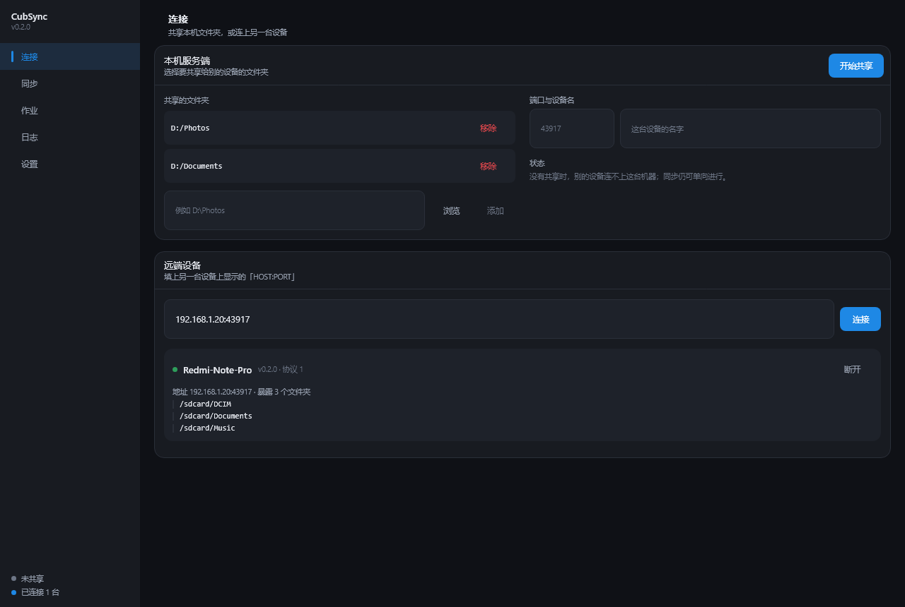
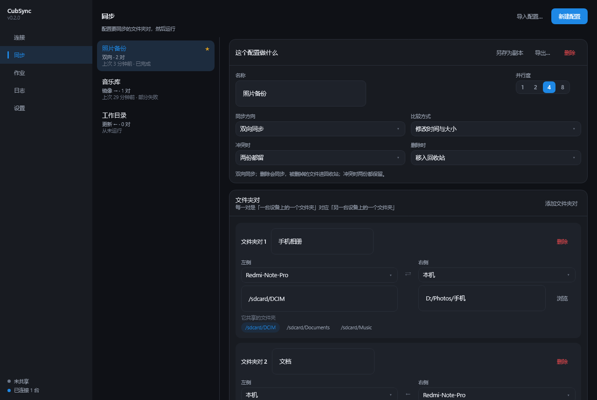
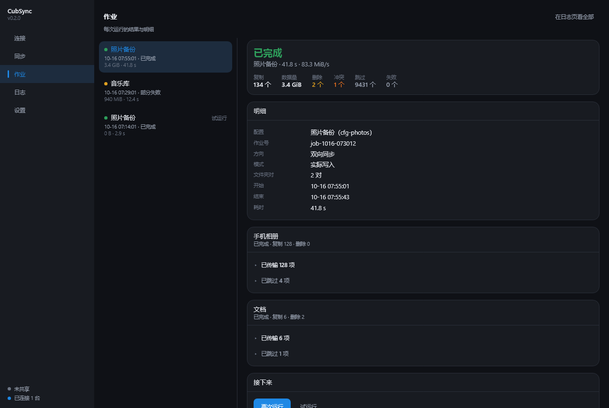

# CubSync

**Cross-platform file sync — one engine, many backends.**

CubSync keeps folders in sync between your devices over your own network. Android,
desktop, and headless (daemon) in one codebase, driven by a single synchronization
engine that is agnostic to the transport underneath it.

> Status: **usable, early**. Version 0.3.0 has the engine, the protocol, two
> backends, a CLI and a Windows desktop application that can be installed and used
> without a terminal. Android is next. The wire format can still change between
> minor versions — see [docs/VERSIONING.md](docs/VERSIONING.md).



*Tell this machine what to share, then connect to another machine that is sharing.
Those two things have to be true before anything else can work.*

---

## What it is

A file synchronization tool, not just a file transfer tool. You define pairs of
folders, pick a direction and a comparison strategy, and CubSync works out what
differs and what to do about it.

| | |
|---|---|
| **Directions** | two-way, mirror (one-way), update-only |
| **Comparison** | timestamp + size, content hash, size only |
| **Filters** | include / exclude globs, size and time bounds, per-pair overrides |
| **History** | per-pair snapshots, conflict reporting, isolated retry of failed pairs |
| **Layout** | multiple configurations, each with multiple folder pairs |
| **Resume** | staging file plus an explicit resume offset; interrupted transfers continue |

## Architecture in one paragraph

The synchronization engine talks only to a `RemoteBackend` interface. A LAN
transport (CubSync's own framed protocol), WebDAV, SMB, SFTP, FTP and local
filesystem are all just implementations of that interface. The engine and the UI
have no knowledge of which one is in use, so adding a backend does not touch them.
Only the first-party LAN protocol supports parallel channels.

More detail, including the decisions that are easy to get wrong, in
[docs/ARCHITECTURE.md](docs/ARCHITECTURE.md).

## Platforms

| Target | Status |
|---|---|
| Headless CLI + daemon | works (JVM 17+) |
| Desktop — Windows (Compose Multiplatform) | works; MSI and application image |
| Desktop — macOS / Linux | builds from source; no packaged artefact yet |
| Android (Compose + Material 3) | next |

Single-language codebase: **Kotlin** (Kotlin Multiplatform + Compose Multiplatform)
for every target. `core` is already a multiplatform source set, so the Android and
desktop targets are additions rather than a restructure.

## Repository layout

```
core/           protocol · model · filter · spi · transfer · engine · util
backends/local/ the filesystem as a backend
backends/lan/   a peer's tree over the first-party protocol
service/        the application layer: configs, peers, runs, the folder server, the log
app/desktop/    the desktop application (Compose Multiplatform)
cli/            the command line entry point
testing/        test-only fixtures (in-memory backend, fault injector)
docs/           architecture, versioning, testing, releasing
```

## Building

Requires JDK 17 or newer. The Gradle wrapper is committed; do not use a system
Gradle.

```
./gradlew check          # compile + test, what CI runs
./gradlew :cli:installDist
./cli/build/install/cubsync/bin/cubsync --version
```

Run the desktop application straight from the source tree:

```
./gradlew :app:desktop:run
```

Or build something to hand to somebody:

```
./gradlew :app:desktop:packageMsi            # an installer
./gradlew :app:desktop:createDistributable   # a self-contained folder with CubSync.exe
```

Packaging an MSI makes the build download WiX, so that step needs network access
the first time. The Android target is not wired up yet, so no SDK is needed to
build what is here today.

## Using the desktop application

The window has five screens, and the first one is the only one that has to be
understood before the rest works.



**Connect** — pick the folders this machine shares, press 开始共享, and read out the
address it shows. On the other machine, type that address into 远端设备 and connect.
Both halves are optional: a one-way copy to a peer works without sharing anything
locally, and a folder can be shared without ever connecting out.

**Sync** — a configuration is a policy plus a list of folder pairs. Add a pair by
choosing a device and a folder on each side; the folders the peer exposes are
offered as buttons, so nothing has to be typed from memory. 试运行 compares without
writing anything, 立即同步 does the work.

**Jobs** — what each run did, per folder pair: how much moved, what was skipped and
why, and what failed. 再次运行 retries from the same place.

**Logs** — the live record, filterable by level and by area. This is the screen to
look at when something behaves oddly.

**Settings** — where the state directory is, the defaults a new configuration starts
from, and the theme. The dark and light palettes are the ones in the design
prototype; dark is the default.



## Using the command line

Serve a folder to the network:

```
cubsync serve --root /srv/photos --port 43817 --name nas
```

Look at what a peer offers, then copy to it:

```
cubsync ls nas.local:43817
cubsync push --to nas.local:43817 --remote /srv/photos --from ./photos \
             --direction mirror-to --compare hash --parallel 4
```

The direction defaults to update-only, so a first run cannot delete anything on the
peer; mirroring has to be asked for. Deletions default to `recycle`, which moves the
file into `.cub_trash` inside the root it came from.

A one-off transfer is fine, but the point of the tool is a saved configuration:
several folder pairs, one policy, and a history per pair so a two-way run can tell a
deletion from a new file.

```
cubsync config new --name "photos and docs" --direction two-way
cubsync config add-pair <id> --left local --left-root ~/photos \
                             --right nas.local:43817 --right-root /srv/photos
cubsync config add-pair <id> --left local --left-root ~/docs \
                             --right phone.local:43817 --right-root /sdcard/Docs \
                             --filter '*.tmp' --name "documents"
cubsync config show <id>
cubsync run <id>
```

`cubsync --help` lists every option. `--json` prints a machine-readable summary built
from the same result the text output shows, and the exit code is 0 when every pair
finished, 1 when something did not, and 2 when the command line was wrong.

Configurations and their per-pair snapshots live under `~/.cubsync` by default and
can be moved with `--state-dir`; `cubsync config export` writes a `.cubcfg` that can
be imported on another machine.

## Testing

```
./gradlew check
```

Every suite in the repository: the protocol codec and its malformed inputs, the
filter dialect, the comparison and planning matrices, chunk reordering,
configuration codecs, both backends against real sockets and real files, the engine
driving an in-memory backend that shares no code with the local one, the application
layer over real directories, and the desktop window — which is composed off screen
in the test suite, so a screen that fails to lay out fails the build.

What each layer is for, and the end-to-end acceptance procedure, are in
[docs/TESTING.md](docs/TESTING.md).

## Versioning and releases

Versions follow SemVer with the pre-1.0 rules in
[docs/VERSIONING.md](docs/VERSIONING.md); notable changes are in
[CHANGELOG.md](CHANGELOG.md); the release procedure is in
[docs/RELEASING.md](docs/RELEASING.md).

## Contributing

Please read [CONTRIBUTING.md](CONTRIBUTING.md) before opening a pull request. Two
things there are stricter than usual: one change per pull request, and no copying
code from this project's prior art.

## Security

Please do not open a public issue for security problems. See
[SECURITY.md](SECURITY.md). The LAN protocol is unencrypted and unauthenticated
today, so it is intended for a trusted network until authentication is designed —
that limitation is deliberate and recorded in the changelog.

## License

Apache License 2.0 — see [LICENSE](LICENSE).

Third-party attributions and prior-art credit: see [NOTICE](NOTICE).

---

## Credits and Prior Art

CubSync is written from scratch and contains **no copied source code**. Its design
was informed by earlier work, which we credit here as a statement of fact:

- **[HybridFileXfer](https://github.com/weixiansen574/HybridFileXfer)** (GPL-3.0)
  — informed the core concept: moving files between Android and desktop over a local
  network, and the dual-pane browsing model. No code, files, or protocol definitions
  were copied, ported, or derived. CubSync is therefore not a derivative work of
  HybridFileXfer.
- **FolderSync Pro** — information architecture for multi-pair configuration and job
  history. Design inspiration only.
- **Material Files** — Android file-browser interaction conventions. Design
  inspiration only.
- **FreeFileSync** — the glob dialect users of this class of tool already know, and
  the idea of a per-pair snapshot database. Behavioural reference only.

Trademarks belong to their respective owners; see [NOTICE](NOTICE).

## Differences from prior art

| | HybridFileXfer | CubSync |
|---|---|---|
| Purpose | file transfer | file **synchronization** |
| Direction | one-way, server-driven | bidirectional, peer-to-peer |
| Protocol | first-party only | pluggable backends (SPI) |
| Desktop | command line | GUI (Compose Multiplatform) |
| Resume | limited | staging file + explicit resume offset + snapshots |
| Deletions | — | propagated with a recoverable trash |
| License | GPL-3.0 | Apache-2.0 |
