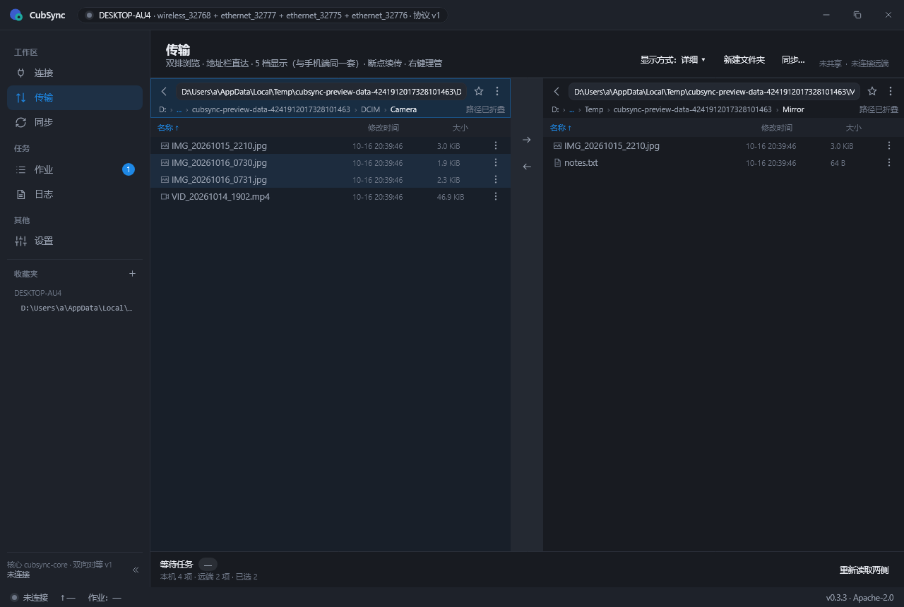
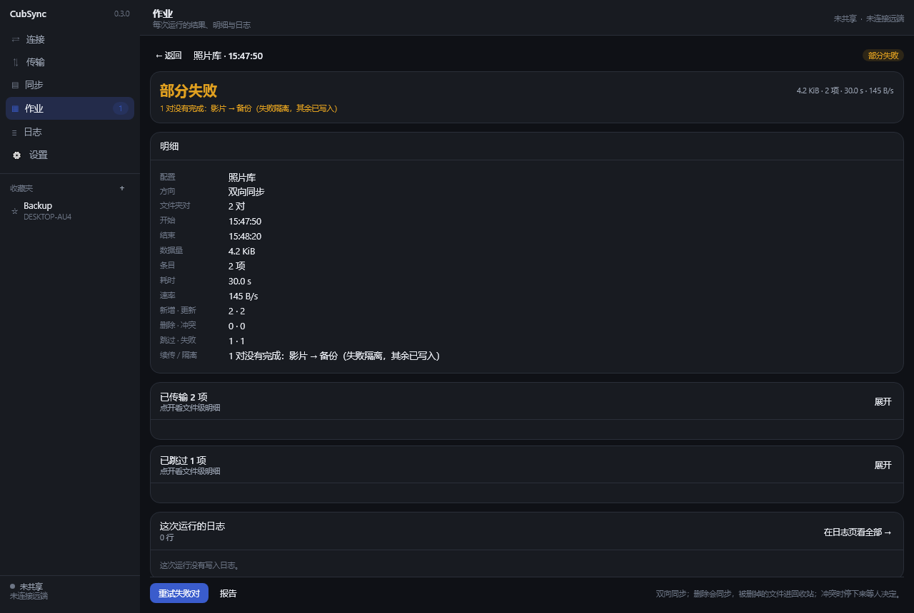
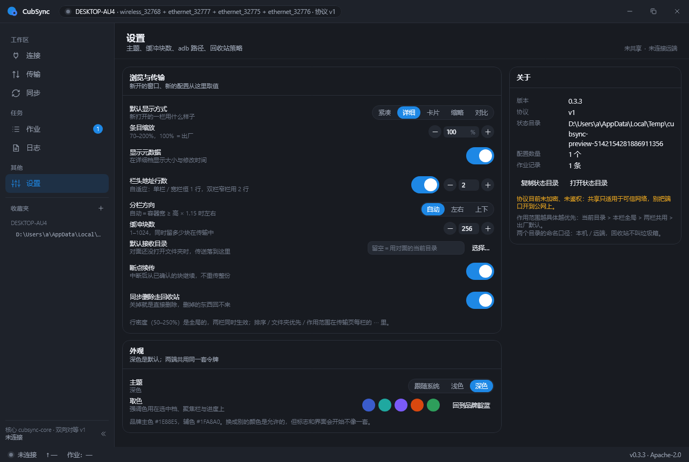
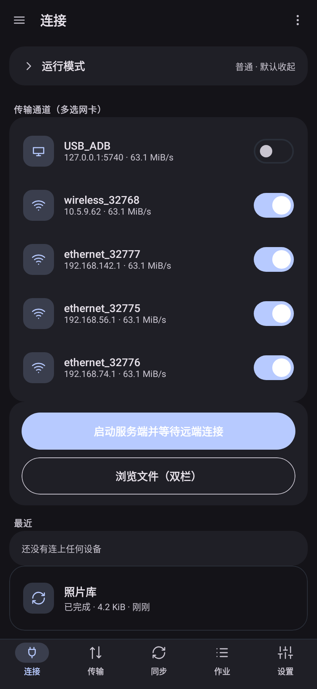
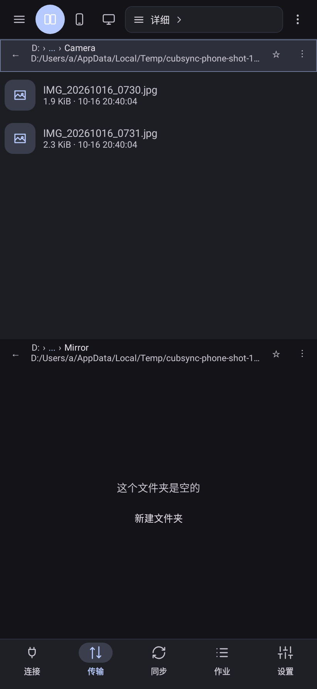
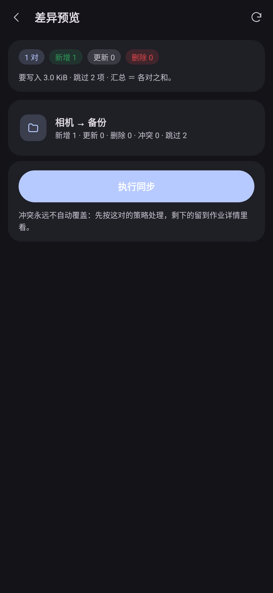
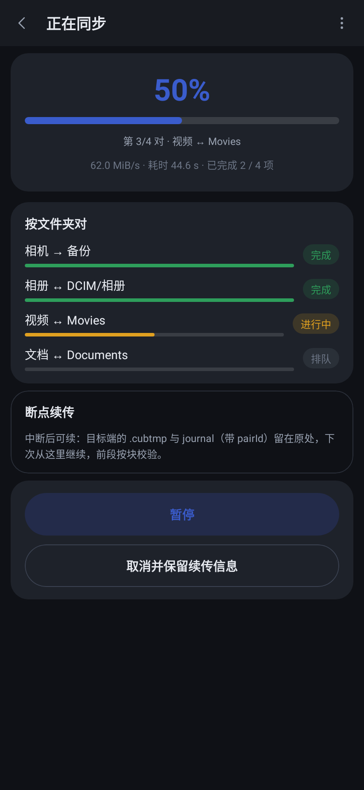
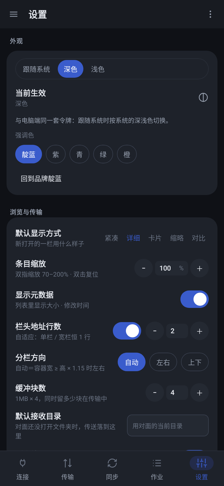

**Cross-platform file sync — one engine, many backends.**

CubSync keeps folders in sync between your devices over your own network. Android,
desktop, and headless (daemon) in one codebase, driven by a single synchronization
engine that is agnostic to the transport underneath it.

> Status: **usable, early**. Version 0.3.1 has the engine, the protocol, two backends,
> a CLI, a Windows desktop application and an Android application, with the interface at
> the design document's level of detail on both ends. One tag produces every platform's
> package under one version number. The wire format can still change between minor
> versions — see [docs/VERSIONING.md](docs/VERSIONING.md).

**▶ [Try the interface prototype](https://cubsync.github.io/demo/)** — both ends, clickable,
in a browser. Nothing to install. The screenshots below are from the real applications; the
prototype is the design at full size.


*Tell this machine what to share, then connect to another machine that is sharing.
Those two things have to be true before anything else can work.*

---

## What it is

A file synchronization tool, not just a file transfer tool. You define pairs of
folders, pick a direction and a comparison strategy, and CubSync works out what
differs and what to do about it.

| | |
|---|---|
| **Directions** | two-way, mirror (one-way), update-only |
| **Comparison** | timestamp + size, content hash, size only |
| **Filters** | include / exclude globs, size and time bounds, per-pair overrides |
| **History** | per-pair snapshots, conflict reporting, isolated retry of failed pairs |
| **Layout** | multiple configurations, each with multiple folder pairs |
| **Resume** | staging file plus an explicit resume offset; interrupted transfers continue |

## Architecture in one paragraph

The synchronization engine talks only to a `RemoteBackend` interface. A LAN
transport (CubSync's own framed protocol), WebDAV, SMB, SFTP, FTP and local
filesystem are all just implementations of that interface. The engine and the UI
have no knowledge of which one is in use, so adding a backend does not touch them.
Only the first-party LAN protocol supports parallel channels.

More detail, including the decisions that are easy to get wrong, in
[docs/ARCHITECTURE.md](docs/ARCHITECTURE.md).

## Platforms

| Target | Status |
|---|---|
| Headless CLI + daemon | works (JVM 17+) |
| Desktop — Windows (Compose Multiplatform) | works; MSI and application image |
| Desktop — macOS / Linux | builds from source; no packaged artefact yet |
| Android (Compose + Material 3) | works; sideload the APK from the release |

Single-language codebase: **Kotlin** (Kotlin Multiplatform + Compose Multiplatform)
for every target. `core` is already a multiplatform source set, so the Android and
desktop targets are additions rather than a restructure.

## Repository layout

```
core/           protocol · model · filter · spi · transfer · engine · util
backends/local/ the filesystem as a backend
backends/lan/   a peer's tree over the first-party protocol
service/        the application layer: configs, peers, runs, the folder server, the log
app/desktop/    the desktop application (Compose Multiplatform)
app/android/    the Android application (Compose, Material 3)
cli/            the command line entry point
testing/        test-only fixtures (in-memory backend, fault injector)
docs/           architecture, versioning, testing, releasing
```

## Building

Requires JDK 17 or newer. The Gradle wrapper is committed; do not use a system
Gradle.

```
./gradlew check          # compile + test, what CI runs
./gradlew :cli:installDist
./cli/build/install/cubsync/bin/cubsync --version
```

Run the desktop application straight from the source tree:

```
./gradlew :app:desktop:run
```

Or build something to hand to somebody:

```
./gradlew :app:desktop:packageMsi            # an installer
./gradlew :app:desktop:createDistributable   # a self-contained folder with CubSync.exe
```

Packaging an MSI makes the build download WiX, so that step needs network access the
first time.

The Android application needs the SDK (API 36 and build-tools 36), pointed at by
either `ANDROID_HOME` or a `local.properties` with `sdk.dir`. It is the only module
that needs one; everything else builds with a JDK alone.

```
./gradlew :app:android:assembleDebug        # app/android/build/outputs/apk/debug/
./gradlew :app:android:installDebug         # straight onto a connected device
```

There is no signed release build yet: that needs a keystore, and a keystore is a
decision about distribution rather than a build step. The APK on each release is the
debug one, which sideloads normally.

## Using the desktop application

The rail has six entries, in the design's order. The first one is the only one that has to
be understood before the rest works.


**连接** — pick the run mode, see which channels are available, then choose the folders
this machine shares and press 开始共享; the addresses to type on the other machine appear
under it. Connecting out is the other half and is independent: a one-way copy to a peer
works without sharing anything locally, and a folder can be shared without ever connecting
out. Accounts and their state, and the last few transfers, are on the same screen.

**传输** — two folders and the arrow between them, which is what the product is named
after. 显示方式 ▾ opens a bar holding all five modes, 行密度 as a typeable percentage,
列数 for the grid modes, 分栏方向 and 条目缩放; it acts on whichever pane you touched
last. Each pane's ⋯ holds its sort order, 文件夹优先 and the three 作用范围 scopes — and
the header of each pane *is* its address: every layer is clickable, the middle folds into a
`⋯`, and clicking the blank part turns it into a box you can type a path into.



**同步** — a configuration is a policy plus a list of folder pairs. The list is on the
left, the configuration on the right: 同步方向, 比较方式, 冲突, 删除 and 并行度, then the
pairs, then 过滤. 预览 compares and shows the summary without writing anything; 试运行 does
the same and records it; 立即同步 does the work.

**作业** — every run, newest first. Open one and it becomes a screen of its own: the
result, thirteen rows of detail, the file-level lists of what was transferred and what was
skipped and why, that run's own log, and the actions its outcome allows — 再次运行, 重试失败对
or 报告.




**日志** — the live record, filterable by level and by area. On the desktop it keeps an
entry of its own, because the window has room for one.

**设置** — the nine browsing and transfer fields the design lists — 默认显示方式, 条目缩放,
显示元数据, 栏头地址行数, 分栏方向, 缓冲块数, 默认接收目录, 断点续传, 同步删除走回收站 — plus
the theme and the accent. The synchronisation policy is deliberately not here: it belongs
to the configuration it governs.



## On a phone

The Android application has five tabs — the desktop's six minus 日志, which belongs to the
job it came from — and the same words, the same step counts and the same states. Those
come from one place (`UiSpec` in the `service` module), so the two ends cannot describe the
same setting differently.

**连接** — the run mode card first, because on a phone it is the question underneath
everything else, and collapsed, because somebody who is not fighting permissions should not
have to read about them. Then the channels — one switch per network card this machine
actually has, with the address it can be reached at — then sharing, then the accounts and
their state, then the last few transfers.



**传输** — the same two panes, with the design's own sub-row: ☰ for the drawer, a
three-way switch between both panes and either one alone, 显示方式▾, and ⋮. The display bar
hangs under it with the five modes, 行密度 as a percentage you can type, 列数 for the grid
modes, 分栏方向 and 条目缩放. A long press on a row opens its action panel; the header of a
pane is its address, exactly as on the desktop.



**同步** — the list of configurations, and each of them opened with `←`: the policy as four
rows that open a list, the pairs, the filter, then 预览 as a layer of its own. A value with
six choices is a row rather than a dropdown, because a dropdown is a mouse's affordance;
the values are the same on both ends either way.




**作业** — every run, and one run opened in full: the result, the thirteen detail rows, the
file-level lists, that run's log inline, and the actions it ended with. 日志 is the second
segment of this tab rather than a tab of its own.

**设置** — the same nine fields as the desktop, in the same order, with the same defaults,
and the appearance above them.



Those five images are not mock-ups: `PhoneScreenshotTest` composes every phone screen on the
JVM and writes it to a PNG. See [docs/TESTING.md](docs/TESTING.md).

## Using the command line

Serve a folder to the network:

```
cubsync serve --root /srv/photos --port 43817 --name nas
```

Look at what a peer offers, then copy to it:

```
cubsync ls nas.local:43817
cubsync push --to nas.local:43817 --remote /srv/photos --from ./photos \
             --direction mirror-to --compare hash --parallel 4
```

The direction defaults to update-only, so a first run cannot delete anything on the
peer; mirroring has to be asked for. Deletions default to `recycle`, which moves the
file into `.cub_trash` inside the root it came from.

A one-off transfer is fine, but the point of the tool is a saved configuration:
several folder pairs, one policy, and a history per pair so a two-way run can tell a
deletion from a new file.

```
cubsync config new --name "photos and docs" --direction two-way
cubsync config add-pair <id> --left local --left-root ~/photos \
                             --right nas.local:43817 --right-root /srv/photos
cubsync config add-pair <id> --left local --left-root ~/docs \
                             --right phone.local:43817 --right-root /sdcard/Docs \
                             --filter '*.tmp' --name "documents"
cubsync config show <id>
cubsync run <id>
```

`cubsync --help` lists every option. `--json` prints a machine-readable summary built
from the same result the text output shows, and the exit code is 0 when every pair
finished, 1 when something did not, and 2 when the command line was wrong.

Configurations and their per-pair snapshots live under `~/.cubsync` by default and
can be moved with `--state-dir`; `cubsync config export` writes a `.cubcfg` that can
be imported on another machine.

## Testing

```
./gradlew check
```

Every suite in the repository: the protocol codec and its malformed inputs, the
filter dialect, the comparison and planning matrices, chunk reordering,
configuration codecs, both backends against real sockets and real files, the engine
driving an in-memory backend that shares no code with the local one, the application
layer over real directories, the Android application's state and navigation, and the
desktop window — which is composed off screen in the test suite, so a screen that
fails to lay out fails the build.

What each layer is for, and the end-to-end acceptance procedure, are in
[docs/TESTING.md](docs/TESTING.md).

## Versioning and releases

Versions follow SemVer with the pre-1.0 rules in
[docs/VERSIONING.md](docs/VERSIONING.md); notable changes are in
[CHANGELOG.md](CHANGELOG.md); the release procedure is in
[docs/RELEASING.md](docs/RELEASING.md).

## Contributing

Please read [CONTRIBUTING.md](CONTRIBUTING.md) before opening a pull request. Two
things there are stricter than usual: one change per pull request, and no copying
code from this project's prior art.

## Security

Please do not open a public issue for security problems. See
[SECURITY.md](SECURITY.md). The LAN protocol is unencrypted and unauthenticated
today, so it is intended for a trusted network until authentication is designed —
that limitation is deliberate and recorded in the changelog.

## License

Apache License 2.0 — see [LICENSE](LICENSE).

Third-party attributions and prior-art credit: see [NOTICE](NOTICE).

---

## Credits and Prior Art

CubSync is written from scratch and contains **no copied source code**. Its design
was informed by earlier work, which we credit here as a statement of fact:

- **[HybridFileXfer](https://github.com/weixiansen574/HybridFileXfer)** (GPL-3.0)
  — informed the core concept: moving files between Android and desktop over a local
  network, and the dual-pane browsing model. No code, files, or protocol definitions
  were copied, ported, or derived. CubSync is therefore not a derivative work of
  HybridFileXfer.
- **FolderSync Pro** — information architecture for multi-pair configuration and job
  history. Design inspiration only.
- **Material Files** — Android file-browser interaction conventions. Design
  inspiration only.
- **FreeFileSync** — the glob dialect users of this class of tool already know, and
  the idea of a per-pair snapshot database. Behavioural reference only.

Trademarks belong to their respective owners; see [NOTICE](NOTICE).

## Differences from prior art

| | HybridFileXfer | CubSync |
|---|---|---|
| Purpose | file transfer | file **synchronization** |
| Direction | one-way, server-driven | bidirectional, peer-to-peer |
| Protocol | first-party only | pluggable backends (SPI) |
| Desktop | command line | GUI (Compose Multiplatform) |
| Android | — | GUI (Compose, Material 3) |
| Resume | limited | staging file + explicit resume offset + snapshots |
| Deletions | — | propagated with a recoverable trash |
| License | GPL-3.0 | Apache-2.0 |
